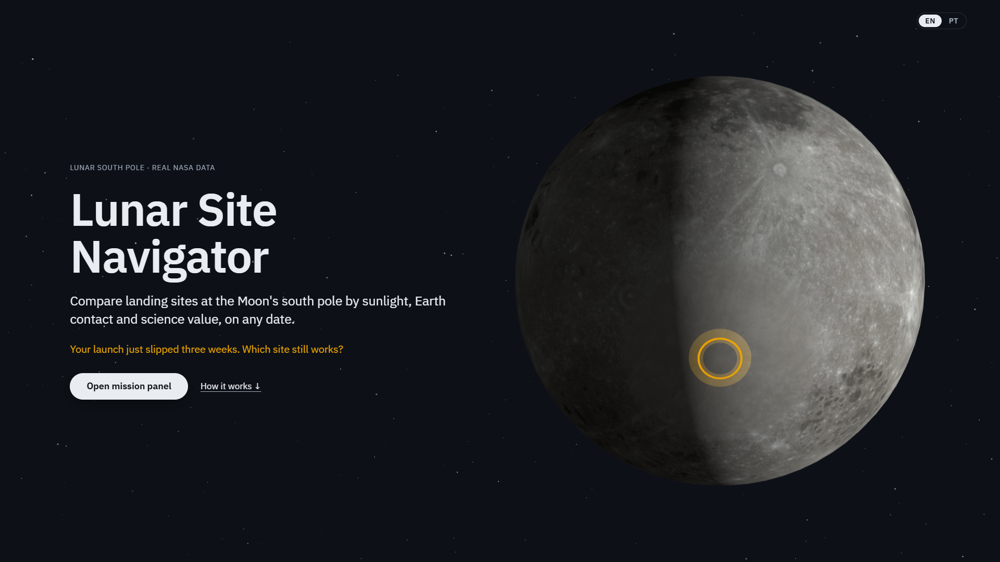
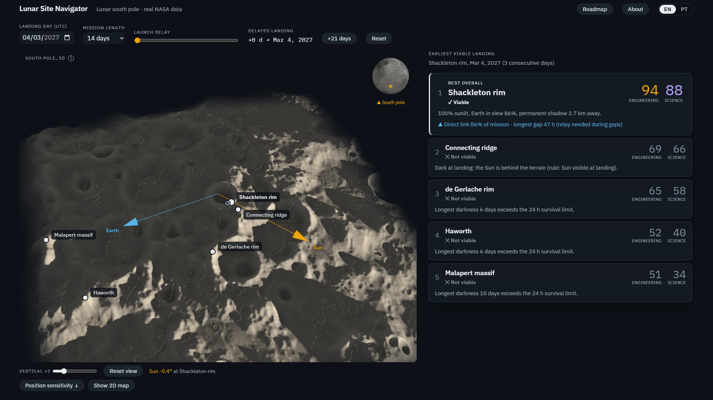

# Lunar Landing Site Navigator

> NASA Space Apps Challenge 2026 — challenge: **[Lunar Landing Site Navigator](https://www.spaceappschallenge.org/2026/challenges/lunar-landing-site-navigator/)**
> Status: early development (hackathon, November 14–15, 2026). See [`docs/ROTEIRO.md`](docs/ROTEIRO.md) for current progress (team docs are in Portuguese).

**"Your launch just slipped three weeks. Which site still works for science and engineering?"**

A lightweight, static web tool that lets mission planners, educators and the public compare candidate landing sites and dates near the lunar south pole — showing, for each site and time, whether the **Sun** (power) and the **Earth** (direct-to-Earth communication) are above the real terrain horizon.





More screenshots (1920 × 1080 and 1366 × 768, English and Portuguese) in [`web/docs/screenshots/`](web/docs/screenshots/).
>
> 🔗 **[PLACEHOLDER — live demo link]**
>
> 🎬 **[PLACEHOLDER — demo video link]**

---

## The problem

At the lunar south pole the Sun and the Earth stay very low on the horizon. Whether a lander gets sunlight for power, or a line of sight to Earth for communication, is decided by the surrounding terrain — a crater rim or a mountain a few kilometres away can block them for days.

The data needed to answer this already exists (JPL Horizons ephemerides, LOLA topography, LROC Quickmap, Moon Trek), but it is scattered across specialist tools. When a mission schedule slips, there is no quick way to compare the alternatives.

## Our angle: science vs. engineering

- **Science** wants to land close to permanently shadowed regions (PSRs), where water ice may be trapped.
- **Engineering** wants sunlight and a direct line of sight to Earth.

The tool shows both sides on the same screen — illumination and Earth visibility next to distance to the nearest permanent shadow — and highlights the best compromise for the chosen dates.

## How it works

Everything is converted to a single point of view: **the sky as seen from the landing site**, described by **azimuth** (direction) and **elevation** (height above the horizon).

1. **Ephemerides** — JPL Horizons gives the azimuth and elevation of the Sun and the Earth, hour by hour, from each site (against an ideal, flat horizon).
2. **Terrain horizon** — LOLA topography (NASA Goddard PGDA) is turned into a 360° horizon profile: for each azimuth degree, the elevation angle of the terrain.
3. **Visibility rule** — a body is visible when its elevation is greater than the terrain elevation in the same direction.
4. **Science value** — the PGDA permanent-shadow map gives each site's distance to the nearest permanently shadowed region.

A small Python pipeline precomputes the terrain horizon and the Sun/Earth series and exports them to `data/app/` (about 350 KB per site; format in [`docs/CONTRATO_DE_DADOS.md`](docs/CONTRATO_DE_DADOS.md)); a static site (Vite + React + TypeScript) reads them. The visibility rule and all metrics live in a single tested TypeScript module in the web app — the same code is used to validate our results against NASA's published illumination. No server.

Architecture details: [`docs/ARQUITETURA.md`](docs/ARQUITETURA.md). Data format: [`docs/CONTRATO_DE_DADOS.md`](docs/CONTRATO_DE_DADOS.md).

## NASA data used

| Source | What we use it for |
|--------|--------------------|
| [JPL Horizons](https://ssd.jpl.nasa.gov/horizons/) ([API](https://ssd-api.jpl.nasa.gov/doc/horizons.html)) | Sun and Earth azimuth/elevation from each site |
| [LOLA polar topography and PSR map — PGDA product 90](https://pgda.gsfc.nasa.gov/products/90) | Terrain horizon; distance to permanent shadow |
| [LOLA 5 m site tiles — PGDA product 78](https://pgda.gsfc.nasa.gov/products/78) | Higher-resolution terrain near sites (if time allows) |
| [Average illumination — PGDA product 69](https://pgda.gsfc.nasa.gov/products/69) | Validation of our computed illumination |
| [LROC Quickmap](https://quickmap.lroc.asu.edu/), [Moon Trek](https://trek.nasa.gov/moon/) | Visual cross-checks and context |

Full list: [`docs/REFERENCIAS.md`](docs/REFERENCIAS.md).

## Check against NASA averages (stage 6)

Share of 2027 hours with any part of the disc above the terrain horizon, computed by the app's own visibility code, beside NASA's 18.6-year averages (PGDA product 69, 60 m pixel). Nothing was tuned to bring them closer.

| Site | Sun: ours / NASA (%) | Earth: ours / NASA (%) |
|---|---|---|
| Shackleton rim | 86.6 / 87.1 | 50.1 / 53.8 |
| Connecting ridge | 89.5 / 88.4 | 55.0 / 58.1 |
| de Gerlache rim | 84.5 / 82.7 | 59.7 / 61.4 |
| Malapert massif | 84.8 / 81.9 | 59.3 / 58.7 |
| Haworth | 74.6 / 70.5 | 63.7 / 60.1 |

Equality is not expected: one year against 18.6 years, 20/80/320 m terrain with a 2 m mast against a 60 m map, and a single 60 m pixel that can change by tens of points within about 90 m. Full table with NASA's 3×3 range: [`data/validation/COMPARISON.md`](data/validation/COMPARISON.md) (`npm run report:nasa` in `web/`).

## Candidate sites (fixed list)

Shackleton rim · Connecting ridge · de Gerlache rim · Malapert massif · Haworth · plus *Shackleton inner wall* (sensitivity demo)

These are **regional reference points**, not NASA-designated landing sites. Latitude/longitude in degrees, lunar mean-Earth frame (MOON_ME, DE421), east-positive longitude.

| Site | Lat | Lon | Point |
|---|---|---|---|
| Shackleton rim | -89.686429 | -162.937143 | brightest NASA-illumination pixel in region Site04 |
| Connecting ridge | -89.474851 | -137.443138 | brightest pixel in region Site01 |
| de Gerlache rim | -88.664627 | -68.395645 | brightest pixel in region Site11 |
| Malapert massif | -86.001142 | 2.055017 | brightest pixel in region Site23 |
| Haworth | -86.368514 | -23.276449 | brightest pixel in region Haworth |
| Shackleton inner wall (sensitivity demo) | -89.7668 | -171.87 | published Site04 centre, on the crater's inner wall |

Same rule for every region (docs/DECISOES.md D30): inside the NASA region (LOLA 5 m DEM tile, PGDA product 78), the pixel with the highest NASA average solar illumination (PGDA product 69, 60 m), ties broken by the distance to the published region centre (NASA M2M-30044 Lunar Surface Data Book, Table A2.1-1). Published region centres were independently cross-checked against the extents of the LOLA 5 m DEM tiles (PGDA product 78): agreement within 1.3 m.

## Running locally

> **[PLACEHOLDER — instructions will be added as each stage is implemented]**

```bash
# Data pipeline (Python 3.10+)
python -m venv .venv
.venv/Scripts/activate        # Windows; use `source .venv/bin/activate` on Linux/macOS
pip install -r pipeline/requirements.txt
python -m pipeline.ephemeris.run_ephemeris     # stage 1: Sun/Earth ephemerides from JPL Horizons
python -m pipeline.horizon.run_horizon         # stage 2: 360-degree terrain horizon from LOLA (PGDA 90)
python -m pipeline.science.run_science         # stage 3: distance to nearest permanently shadowed region
python -m pipeline.validation.run_reference    # stage 6 data: NASA average illumination / Earth visibility
python -m pipeline.export.run_export           # stage 4: write data/app/ (the files the web app reads)
python -m pipeline.sites.verify_site_points    # cross-check site coordinates against PGDA tiles
ruff check . && pytest                          # lint and tests
# later stages: TBD

# Web interface
cd web
# npm install && npm run dev   — TBD (stage 5)
# `npm run sync-data` copies data/app/ into web/public/data/ and runs before dev and build
```

## Limits (declared)

- **Terrain resolution:** the horizon uses the LOLA 20 m south polar DEM (PGDA product 90) at 20 m up to 5 km from the site, and its 80 m and 320 m overviews up to 40 km and 200 km. Obstacles smaller than those pixels may be missed, and how the overviews were generated is not documented (distant peaks may be slightly lowered).
- **Search radius and DEM edge:** 200 km. Where a ray leaves the DEM (a ±304 km square), terrain beyond is treated as unknown; this affects 13.9% of directions at Malapert massif.
- **Observer:** DEM terrain height plus a 2 m mast (a team choice, not a NASA requirement). Heights are taken as metres above the 1737.4 km sphere, inferred from the datum declared in the DEM file.
- **Best case per region, not a landing area:** every site uses the brightest pixel of NASA's 60 m average-illumination map inside its NASA region (D30), so the comparison is fair; neighbouring 60 m pixels can be far darker, so results show each region's best case. The published Site04 centre lies on Shackleton's inner wall (31° slope) and is kept as "Shackleton inner wall" to show how much the exact position matters.
- **Closed list of sites:** only the five sites above.
- **Date range:** January 1 to December 31, 2027 (UTC), one-hour steps. Launch-slip comparisons only work within this year.
- **Observer height:** ephemerides use an observer at 0 km above the 1737.4 km reference sphere; the effect on Sun/Earth angles is negligible.
- **Leap seconds:** for 2027 JPL Horizons holds the last known leap second constant (possible 1 s offset).
- **NASA reference values:** average solar illumination and Earth visibility at each site come from the LOLA 60 m maps (PGDA product 69), averaged over 18.6 years and counting the Sun/Earth as visible if any part of the disc is unobstructed; they are shown for comparison and are not directly comparable to a single year.
- **Verdict vs. science:** the verdict uses engineering rules only (sunlight, darkness, slope, Earth contact through the engineering score); the science score ranks sites and picks the best compromise but never fails a site (D32).
- **Science indicator:** distance to the nearest permanently shadowed region of at least 1 km² (PGDA product 90). Using proximity to permanent shadow as a science indicator, and the 1 km² bound, are our team's choices, not NASA criteria.
- **Sample data:** while the pipeline is incomplete, the interface may use sample files in the final format. These are always flagged as **sample** in the UI.
- **Fixed decision rules and scoring:** every number comes from NASA data or from fixed, verifiable code; the rules and weights are shown on screen.

## Disclaimer

This is an independent project built for the NASA Space Apps Challenge. It is **not a NASA product**, is not endorsed by NASA, and **must not be used for real mission planning**. It is a decision-support demonstration.

## Team

> **[PLACEHOLDER — team members]**

## License

> **[PLACEHOLDER — license to be defined]**
