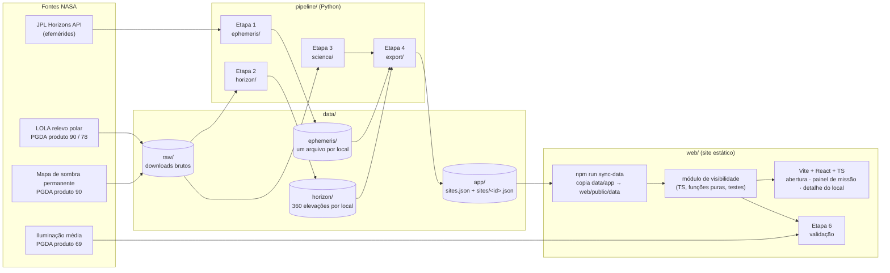
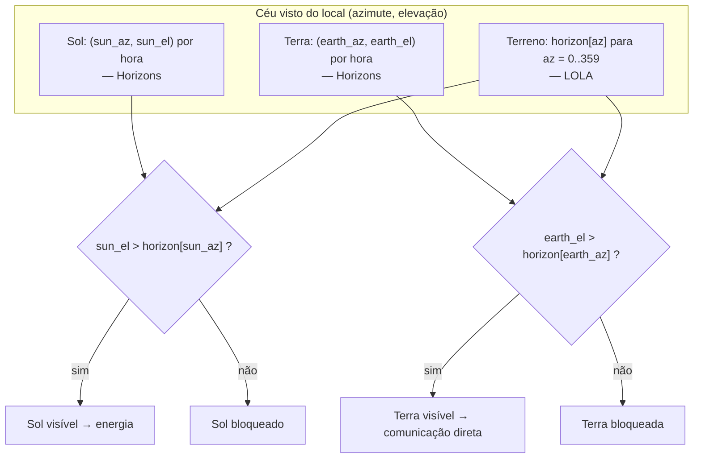

# Arquitetura

## Visão geral

Pipeline Python **offline** que baixa e processa dados da NASA e gera arquivos JSON pequenos. Um **site estático** (Vite + React + TypeScript) lê esses arquivos. Não há servidor.

## Fluxo de dados

- O pipeline exporta **apenas** horizonte e séries do Sol e da Terra (mais metadados e `psr_distance_km`). **Visibilidade e métricas são calculadas na interface**, num único módulo TypeScript; a validação da etapa 6 usa o mesmo módulo (D9).
- A interface lê `web/public/data/`, cópia de `data/app/` feita por `npm run sync-data` antes do dev e do build (D10).
- A etapa 5 (interface) começa em paralelo usando **dados de exemplo no mesmo formato** de `data/app/` (marcados `meta.sample = true`).

## Como os dados se unem

Tudo é convertido para o mesmo ponto de vista: **o céu visto do local de pouso**, descrito por

- **azimute**: direção no plano do horizonte, em graus (0–360);
- **elevação**: altura acima do horizonte, em graus (negativa = abaixo).

1. **JPL Horizons** fornece azimute e elevação do Sol e da Terra, hora a hora, vistos de cada local (observador topocêntrico na superfície lunar). A elevação do Horizons é contra um **horizonte ideal, sem relevo**.
2. **Relevo do LOLA** (NASA Goddard PGDA) vira, para cada direção (1 grau de azimute), a **elevação angular do terreno** vista do local. É o contorno do horizonte.
3. **Regra de visibilidade:** o astro está visível se a elevação dele é **maior** que a do terreno na mesma direção:
   `visível(t) = el_astro(t) > horizon[round(az_astro(t)) mod 360]`
   Essa regra vive num único módulo TypeScript da interface (D9); o método exato de interpolação entre graus será definido na etapa 5 e registrado em `DECISOES.md`.
4. **Mapa de sombra permanente** (PGDA) dá a distância de cada local até a sombra permanente mais próxima — o **valor científico**.

Com isso, cada local recebe, para qualquer janela de datas:

- **% de horas com Sol** (proxy de energia);
- **% de horas com a Terra visível** (proxy de comunicação direta);
- **distância à sombra permanente** (proxy de valor científico).

### Condições para a união funcionar

- **Mesmo referencial:** as coordenadas enviadas ao Horizons e as do relevo devem estar no mesmo referencial lunar. `PENDENTE:` confirmar que ambos usam MOON_ME (ver `DADOS.md`).
- **Mesma convenção de azimute:** Horizons e o horizonte calculado devem medir o azimute do mesmo jeito (origem e sentido). `PENDENTE:` confirmar a convenção do Horizons e adotá-la no cálculo do horizonte; registrar em `CONTRATO_DE_DADOS.md`.
- **Tempo em UTC** em todos os arquivos.

## Onde cada coisa roda

| Parte | Quando roda | Onde |
|-------|-------------|------|
| Pipeline (etapas 1–4) | Uma vez, na máquina do time | `pipeline/` |
| Sincronização de dados | Antes do dev e do build (`npm run sync-data`) | `data/app/` → `web/public/data/` |
| Interface (etapa 5) | No navegador do visitante | `web/`, lendo `web/public/data/` |
| Validação (etapa 6) | Uma vez, na máquina do time | script/teste TypeScript em `web/`, usando o módulo de visibilidade |

Os cálculos pesados (efemérides, horizonte, distâncias) ficam no pipeline. No navegador ficam a regra de visibilidade e as métricas sobre os dados pré-calculados, num único módulo de funções puras.
